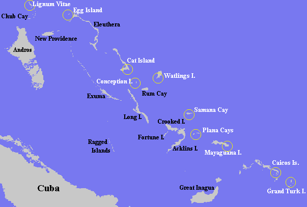
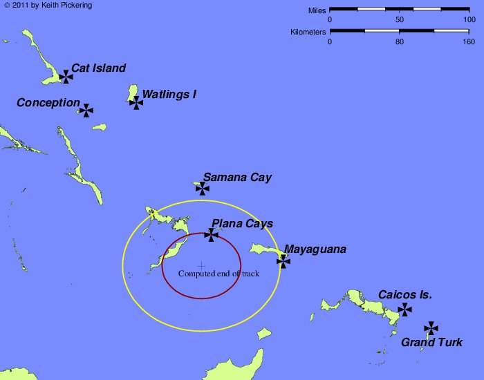
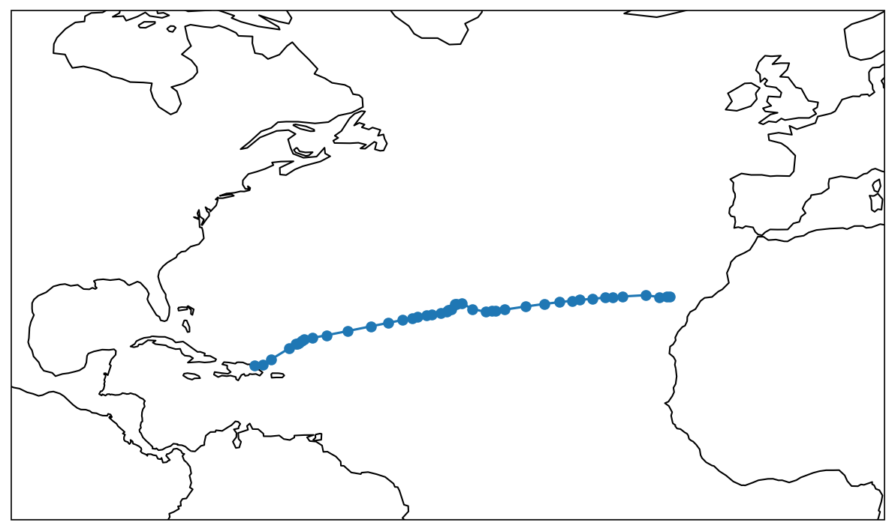
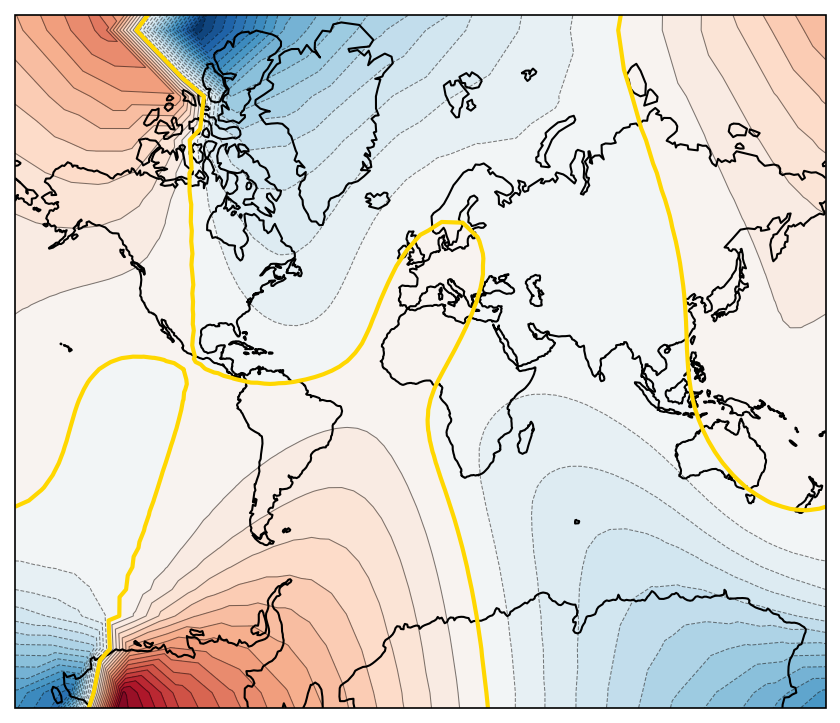
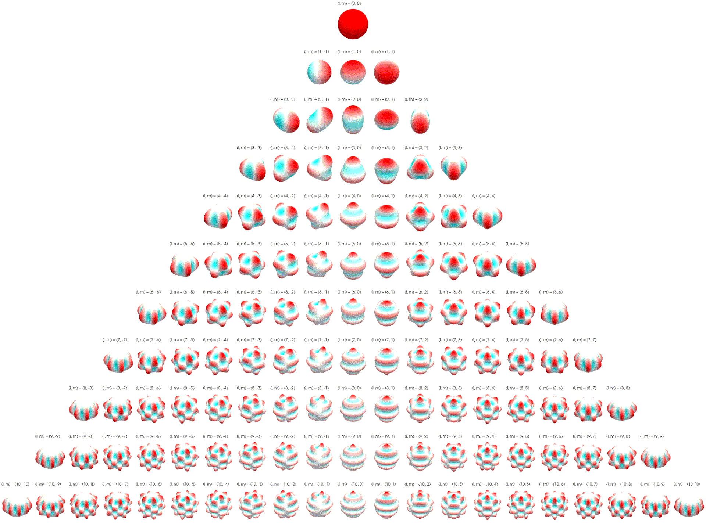
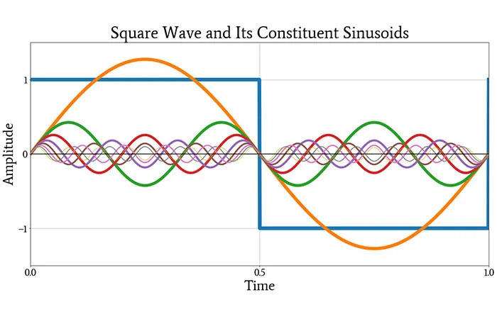
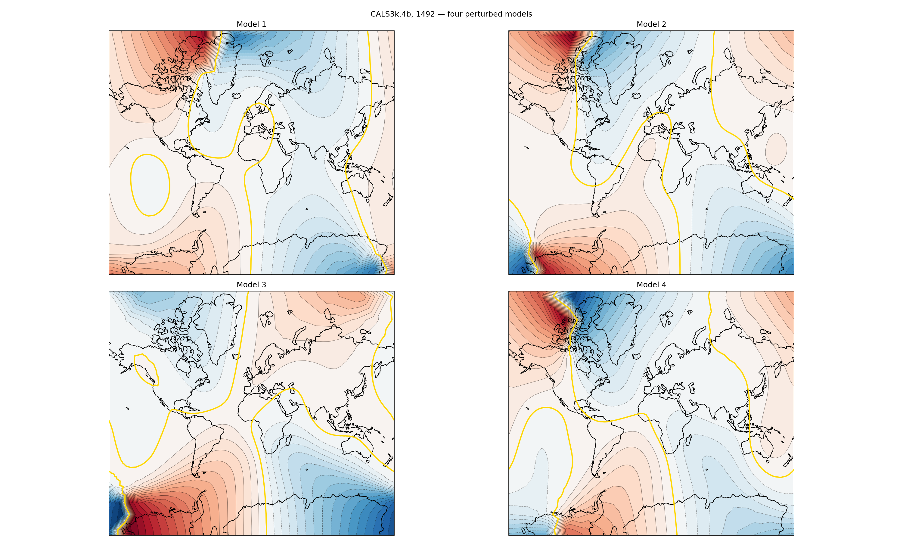
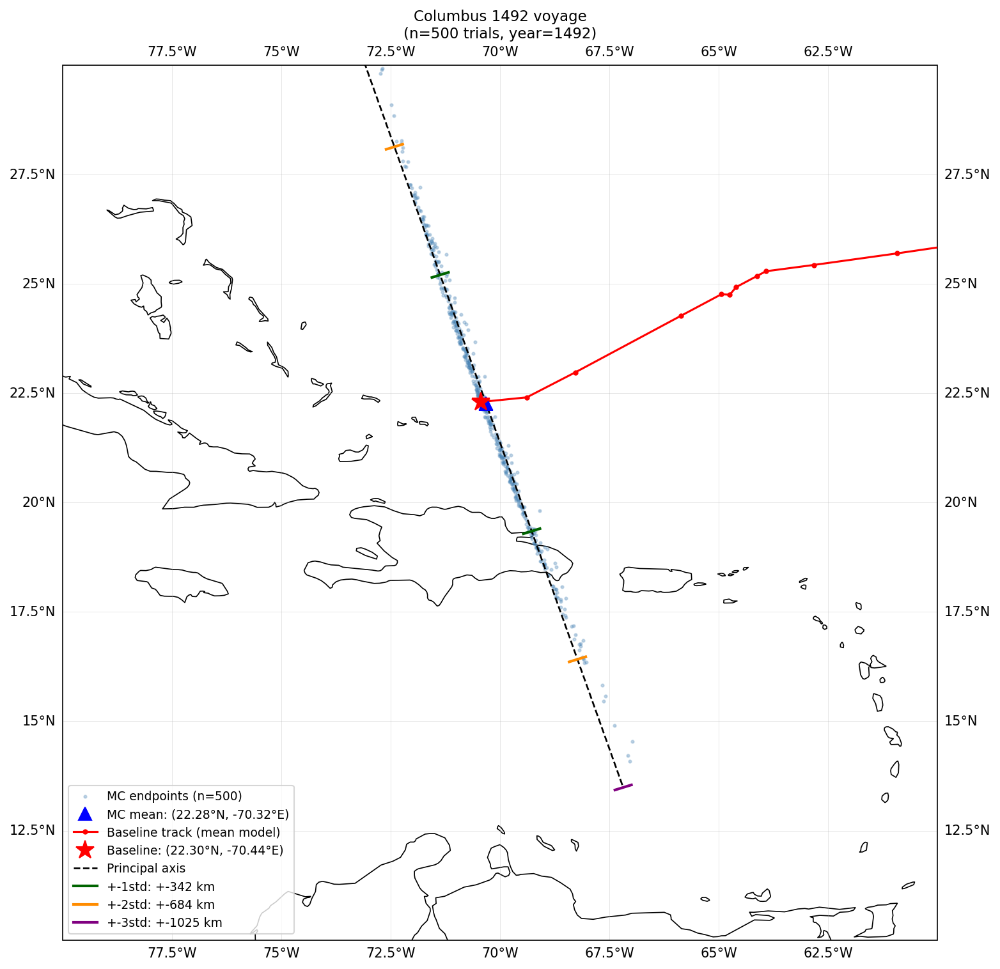

+++
title = "Columbus Landfall"
date = "2026-10-03"
done = false
[[tags]]
tag = "Geography"
[[tags]]
tag = "Simulation"
+++

# Columbus Landfall - Transatlantic Tracking

On October 12, 1492, Christopher Columbus landed in the new world. To put it lightly, this ended up being a **pretty big deal**. The European *"discovery"* of the Americas kicked off centuries of westward exploration and colonization; It's sometimes considered to be the start of the "modern era."

So, considering the vast historical impact, you may be shocked to learn that we have no idea *where* he landed.

We know the general details. He landed on a small island in the Eastern Caribbean which locals called *Guanahani*, and Columbus called *San Salvador*. The issue is that there are many small islands in the Eastern Caribbean, and we have very little information to help narrow it down.

Columbus kept a log during the journey, but this disappeared soon after he returned.  The best historical record we have is an abstract of that log, called the *Diario.* This abstract leaves a lot to be desired detail-wise, but it's the only definitive source on *San Salvador* we have.  The island was never reidentified on future voyages, and no other log of its location survives.  

Over the years people have proposed many theories.



The 'official' identity is *Watlings Island* (since renamed to *San Salvador*, which made researching this very annoying). Personally I think that *Watlings* is a pretty unlikely candidate (I prefer the *Plana Cays*), but the purpose of this article isn't to come to any conclusion about the identity of the island.  Instead I'd like to offer a critique of one common method researchers use to pin it down.

We know that Columbus began his journey in the *Canary Islands,* then landed in *Guanahani*, then visited a series of unidentified Caribbean islands, and finally ended up in *Cuba.* This gives us 3 methods to find *Guanahani*:
* Using the description of the *Guanahani* itself
* Tracking his path backwards from *Cuba*
* Tracking his path forwards from the *Canaries*

It's that last method I'd like to discuss.

---

## Transatlantic Tracking

The basic concept behind this method is to start in the Canaries, take the distances and headings Columbus noted in his logs, and trace them across the Atlantic.  Then the final location must be *Guanahani*!  

If only it were that simple.  

Even assuming Columbus's measurements were accurate, and the *Diario* transcribed them well, a few factors make this tracking method a lot more difficult than it sounds.  For one, there are ocean currents.  Columbus would have noted down his distances travelled based on how he *appeared* to be moving relative to the water, but that doesn't account for how the water itself was moving.  Wind would have had a similar effect (called leeway), shifting the ship in ways that are difficult to estimate.  Another difficult thing to account for is the magnetic field.  Columbus logged his headings based on compass readings, but compasses don't point to true North, they point to magnetic North, and they don't even do that very well.  The geomagnetic field is fairly irregular, a compass in Texas will point about 4° East of true North, but a compass in Maine will point 16° West.  To make matters even more complicated, magnetic north and the field irregularities change and shift over time.  They would have been very different in 1492.  

I've found seven serious attempts find *Guanahani* this way, and each accounts for more of these sources of uncertainty (see [Schott 1880](https://library.oarcloud.noaa.gov/docs.lib/htdocs/rescue/cgs/002_pdf/CSC-0079.PDF), [McElroy 1942](https://www.jstor.org/stable/210010), [Marden 1986](https://dn790008.ca.archive.org/0/items/edg-ng-1981/edg%20NG%201986-11%20170-5%20Nov.pdf), [Peck 1991](https://www.bing.com/ck/a?!&&p=ba20352fb18c60f1bb7991ca45d2e25785ca0d644aaed9ccf880798716be4d60JmltdHM9MTc5MDU1MzYwMA&ptn=3&ver=2&hsh=4&fclid=2afb54b5-c5a7-618f-1eb6-437ac4616036&psq=+Douglas+T.+Peck+1991+columbus+paper&u=a1aHR0cHM6Ly9teW1hbmF0ZWUuY29udGVudGRtLm9jbGMub3JnL2RpZ2l0YWwvYXBpL2NvbGxlY3Rpb24vcDE2NjgxY29sbDIvaWQvNDI5NC9kb3dubG9hZA), [Richardson and Goldsmith 1987](https://www2.whoi.edu/staff/prichardson/wp-content/uploads/sites/75/2018/11/Richardson-Goldsmith-1987-Oceanus-Columbus.pdf) [& 1992](https://www2.whoi.edu/staff/prichardson/wp-content/uploads/sites/75/2018/11/Goldsmith-Richardson-1992-WHOI-92-14.pdf), [Pickering 2004](http://columbuslandfall.com/ccnav/shd2004.shtml)).  The earliest, by Schott, is more or less a direct application of the headings in the logs, with an educated guess at the magnetic field model.  The latest, by Pickering, is so far the most competent (I'd strongly recommend reading it, as well as checking out the rest of [his website](http://columbuslandfall.com/ccnav/cclandfl.shtml), it's one of the better sources of information on this whole topic).  

Pickering's simulations use a huge database of drift measurements from floating sensors (NCEI 0098060) to estimate and give uncertainty on current and wind, and a fascinating dataset called a historical geomagnetic model to estimate the magnetic field. 

The way these magnetic field estimates are made is pretty incredible.  Pickering uses a model called CALS3k, which gives magnetic field estimates for the last 3000 years.  At first glance this seems impossible. How could you know anything about something as ephemeral as the magnetic field so long ago?  Where would you find any data? CALS3k uses data from two main sources:
1. Lake sediment.  As dirt settles to the bottom of lakes tiny iron particles in the silt align themselves to the magnetic field.  Layers and layers of this sediment build up over the years.  By sampling and looking at the orientation of iron in the different layers, we get a record of the direction of the magnetic field at that location going back in time.  
2. Ancient hearthstones.  When rocks get hot iron deposits within them become excited, and can rearrange themselves.  When they cool and settle, they align with the magnetic field.  At archaeological sites where we know the last date of occupation, we can study hearthstones which would have last been heated when the site was in use to find the magnetic field for that location at that time.  

The result of Pickering's study is a landing right next to the Plana Cays.  Given that this result aligns with my personal opinions on the landing spot, it's very tempting to take it at face value.  Unfortunately, I think there are a few problems with it.



First and most obviously: it's old (older than me at least).  The geomagnetic model used is CALS3k.1, the first version of CALS3k.  This model is good, but by virtue of the hard work of many scientists over the last couple decades, we now have access to much more refined versions based on much larger datasets.  Secondly, while Pickering's study accounted for many more sources of uncertainty than its predecessors, it didn't account for all of them.  Notably it takes the geomagnetic model entirely at face value.  I can't fault the study for this as the models available at the time didn't allow for easy estimates of uncertainty, but that doesn't change the fact that this calls its results into question.  

Eventually I decided that if I wanted an analysis of this I was happy with, it would be best to just do it myself.  

---

## Simulation

The first step was finding data.  The Diario lists headings and distances in leagues for each day, though to complicate matters it's not entirely clear *which* leagues these were.  General consensus seems to be that Columbus used a mixture of Italian Leagues (2.67 miles each) and Portuguese leagues (3.2 miles), both fairly antiquated units, but easy to convert.  Gathering the data in the Diario in modern units gave me a table like this: 


From here I started building out my simulation.  In a new python file I used the `Geodesic` library to bring in a `WSG84` geoid, essentially a very accurate model of the Earth's shape.  Helpfully, it also allows us to move a point around on its surface based on distances and headings.  Applying our data from the log we get a path that looks like this:



Next, let's bring in the magnetic field.  I downloaded the latest CALS3k dataset, specifically CALS3k.4b.  The 'b' here indicates it's the more conservative version of the model which means the resolution is a little lower than the standard '.4' model.  *However,* unlike the '.4' model it provides the data needed to measure uncertainties, which we need.  Setting the target year to 1492 and plotting the magnetic declination, effectively the variation of the local magnetic field from true north, gives us a plot that looks like this:



Next: uncertainties.  For this we need to look under the hood of CALS3k.  The raw data for the `4b` model looks like this:

```
-2000.0  1990.0  4 lambda= 0.2D-12 tau= 0.2D-02 gufmend= 0.1D+03 dipole 0.0D+00
10           0         402  -2030.0000000000000       -2020.0000000000000......

-28927.385499129417        185.02365021808725       -785.05269066623782........
4143.4005889697455        2269.7401639210989        2474.5972067662924.........
```

The first two lines are unimportant, the last two are where the magic happens.  Both of these are lists of 48,240 very precise numbers.  So what do they do?

CALS3k, and other similar geomagnetic field models are at their core spheres where every point has a value of some amount of degrees West or East of true North.  These values change smoothly over the sphere, and the overall field changes smoothly over time.  To construct these smooth fields, it uses functions called spherical harmonics, special functions over spheres which can be used to build any other smooth spherical function.  By adding and subtracting different spherical harmonics of increasing degree together, you can approximate any field you want.



You can think of this as being very similar to how Fourier series use sine waves of different frequencies to approach any other function, just instead of a line in 2D we're approximating a function on a sphere.  (Also, if you think back to high school chemistry, you might notice that these shapes look suspiciously like the different electron orbitals! [This is not a coincidence!](https://en.wikipedia.org/w/index.php?title=Atomic_orbital&oldid=1384645609#Real_orbitals))



CALS3k uses all harmonics up to degree 10, which means 120 total (there are `1 + 2n` for each degree `n`).  Then, for every decade between 2030 BCE and 2020 CE, each harmonic gets a weight to determine how much it contributes to the overall field.  If you're not looking at a decade it tracks exactly, it uses the weights of nearby decades as knots in a spline and smoothly interpolates between them, resulting in our field changing smoothly both over the sphere, and throughout time.  This means 120 harmonics, and 402 decades of weights for each, giving us `120 x 402 = 48240` numbers!

The second row contains our uncertainties.  For each knot in each spline, it gives a +- 1 standard deviation uncertainty on that knot's value.  

Finally, we have all the understanding we need for our uncertainty calculations!  For each of the 120 harmonics we find the four closest spline knots (so the years 1480, 1490, 1500, and 1510) and based on their corresponding uncertainties, and a randomly selected normal variable we generate a perturbed set of knots for that harmonic.  Then, after some interpolation on the spline we get our randomly selected weight for that harmonic in 1492!  Doing this for all the harmonics, we get randomly perturbed fields that look like these.  



You'll notice that while there are many similarities, there is also a lot of variation.  This is particularly true in the far East and global South, which is where CALS3k has the least data to draw from.  Luckily for us, the best data is almost all from Europe and North America, which means the declination in the Northern Atlantic, the part we care about, is relatively stable.  

Lets plug it into the sim!  I set up a Monte Carlo sim which would run 500 voyages and select a randomly perturbed version of the magnetic field for each.  After that, all that's left is to account for ocean currents and wind, which there are plenty of good data sets for.  Then we'll finally know where Columbus landed!



Oh...

Well that's not good.

---

## Interpretation

As you can see, there's a lot of variation in the final position, so much variation that the result is basically useless.  While the overall field doesn't change much, tiny variations compound over the long cross Atlantic track, resulting in totally different endpoints.  The one standard deviation range is enough to cover every proposed landing site.  The three standard deviation range spans nearly the entire Caribbean.  

At this point I didn't even bother incorporating the ocean drifter data.  That would have only introduced more uncertainty, and the results were already imprecise enough that they were useless.  

Ultimately the result of all this is that the cross Atlantic tracking isn't a useful method of finding *San Salvador*.  Even assuming the *Diario* is accurate, none of our data is precise enough to derive any meaningful result from it.  In my opinion, this route is a dead end.  

While this result is mildly disappointing, it's still useful.  It shows that focus should be centered on the other two tracing methods (based on the *Guanahani's* description and backtracking from *Cuba*).  Also it was a lot of fun!  The math was neat, and learning about the incredible ways these datasets are made was fascinating.  

You can find all the code and simulations I wrote for this [on my github](https://github.com/FATCullen/columbus/tree/main).  