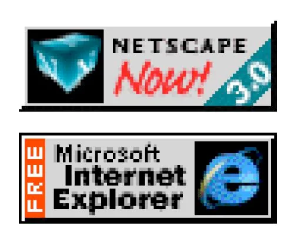

+++
title = "(Steal These) Web Badges"
date = "2026-11-19"
done = true
[[tags]]
tag = "Old/Small Web"
+++

# (Steal These) Web Badges

You may have noticed several small images serving as links on the front page of my website.  These are called web badges!  

Web badges are a sort of relic of the old internet.  There are a few stories about their origin, a common one is that that they were created in 1995 at the height of the Netscape Navigator vs. Internet Explorer browser war.  Browser compatability was hit or miss in those days, there was a serious chance a site designed for one browser would have issues in another.  Because of this, Netscape created a small badge, a `88x31` image which users could display on their site to indicate it was best viewed with their browser, and Microsoft soon made one of their own.  

From here, the idea kind of exploded.  `88x31` became a standard size for people to make images to indicate just about anything.  Software developers began making badges for their programs so people could show that they used it.  Website owners made badges for their sites, so other people could link back to them.  [A good portion were just made for fun.](https://88x31.nl).  It was pretty typical for sites to have a big block of webbadges at the bottom, and the standardized `88x31` size ensured they all fit together nicely in a grid.  

You might notice though that my web badges look a little different.  Indeed, they're a fair bit smaller, only `80x15`.  This is the other standard webbadge size, which was created later in 2002 when blogger Antipixel made [this post](https://web.archive.org/web/20021205225407/http://www.antipixel.com/blog/archives/2002/10/22/steal_these_buttons.html) showing them off.  They were a nice, simpler alternative to the larger buttons, and soon they too became [wildly popular](https://web.badges.world/).  To distinguish them from the other size, you may sometimes see these called 'Antipixel buttons' or 'brilliant buttons.'

This format never really died out either, the badges you see at the top of many github repos are descended from them.  

# Using Web Badges Now

While they may be old, I still like web badges.  They are a great way to fit a bunch of links in one place without using a bunch of plain icons that blend into each other, or a wall of text.  Plus they've been around so long there's almost certainly one for whatever you need, and if there isn't they're fun and easy to make.  

Displaying them is dead easy too, though make sure to use `image-rendering: crisp-edges` (or `pixelated`) so they look sharp.

I made several of the badges for my site myself, feel free to steal them!  If you'd like to link back to my site, use this one:

I made these two for the old / small web protocols [gopher](https://en.wikipedia.org/w/index.php?title=Gopher_(protocol)&oldid=1386495286) and [gemini](https://geminiprotocol.net/) since I host this site on them too:

If by some miracle you happen to be a fellow University of Waterloo Software Engineering student, I made this badge for [our webring](https://se-webring.xyz/) (another relic of the old internet): 

And I made these LinkedIn and Github badges to link to some of my other profiles:

And finally here's all the other web badges I use or like:

Enjoy!